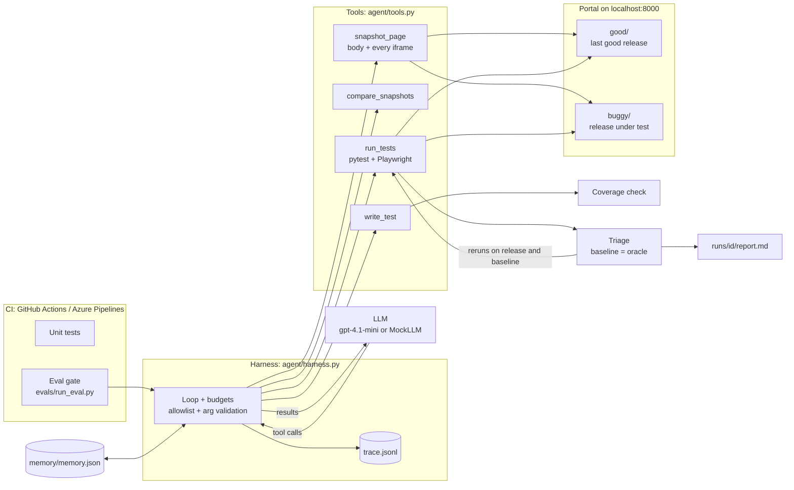

# PortalGuard

[](https://github.com/anupbpote02/portalguard/actions/workflows/qe.yml)

PortalGuard is an AI QE agent that tests each new release of a hospital patient portal before
patients see it. Patient portals change often and break quietly: a heading disappears and a screen
reader user can no longer find their lab results, or a "Download PDF" button stops working inside
an embedded frame that nobody re-tested. PortalGuard compares the accessibility tree of every page
**and every iframe** against the last good release, writes and runs Playwright tests for the key
patient journeys, repairs its own broken tests, and reports only bugs it can back with evidence. A
custom harness, not the model, decides what counts as a bug, and it runs in GitHub Actions and Azure
DevOps.

It's built against a fictional hospital, "Harbor General", with a good release and a buggy release
that has 4 planted bugs. All data is synthetic.

## Contents

- [Quick start](#quick-start)
- [Architecture](#architecture)
- [How each requirement is covered](#how-each-requirement-is-covered)
- [Harness design](#harness-design)
- [Eval results](#eval-results)
- [Healthcare notes](#healthcare-notes)
- [Known limitations](#known-limitations)
- [Next steps for a real client engagement](#next-steps-for-a-real-client-engagement)
- [Project layout](#project-layout)

## Quick start

Needs Python 3.12. Mock mode needs no API key and costs $0.

**Windows (PowerShell)**

```powershell
git clone https://github.com/anupbpote02/portalguard.git
cd portalguard
py -3.12 -m venv .venv
.venv\Scripts\Activate.ps1
pip install -r requirements.txt
python -m playwright install chromium

# terminal 1: serve the portal (good release at /good/, buggy release at /buggy/)
python -m http.server 8000 --directory portal

# terminal 2
python -m agent.main --mock          # agent on the buggy release, scripted LLM
python -m evals.run_eval             # score it against the planted bugs (mock, about 2 minutes)
python -m pytest tests/unit -q       # 47 unit tests, no browser
```

**macOS / Linux**

```bash
git clone https://github.com/anupbpote02/portalguard.git
cd portalguard
python3.12 -m venv .venv
source .venv/bin/activate
pip install -r requirements.txt
python -m playwright install --with-deps chromium   # --with-deps installs Linux system libraries

python -m http.server 8000 --directory portal &      # or use a second terminal
python -m agent.main --mock
python -m evals.run_eval
python -m pytest tests/unit -q
```

**Test patients** (from `portal/test-users.json`; sign in at http://localhost:8000/good/ or /buggy/)

| Name | Email | Password | MRN |
|---|---|---|---|
| Jordan Rivera | `jordan.rivera@test.example` | `Test123!` | `TEST-000123` |
| Casey Morgan | `casey.morgan@test.example` | `Test456!` | `TEST-000456` |
| Riley Nguyen | `riley.nguyen@test.example` | `Test789!` | `TEST-000789` |

MRN = Medical Record Number. All patients are fictional; every MRN starts with TEST-.

Each run writes `runs/<timestamp>/report.md` (bugs with evidence), `trace.jsonl` (every step),
the snapshots, and the tests the agent wrote.

**Other useful commands**

| Command | What it shows |
|---|---|
| `python -m agent.main --mock --release http://localhost:8000/good/` | Same agent on the good release: 0 bugs |
| `python -m agent.main --mock --scenario guardrails` | A misbehaving model: bad arguments and off-site URLs, stopped by the harness |
| `python -m agent.main --mock --scenario runaway` | A looping model, stopped cleanly at 25 steps |
| `python -m agent.main --mock` twice | The second run reuses memory: about half the time, bugs marked KNOWN |
| `python -m agent.diff_releases` | Just the aria snapshot diff, good vs buggy, no LLM |
| `python -m evals.run_eval --real --repeat 3` | Real gpt-4.1-mini eval (needs `OPENAI_API_KEY` in `.env`, about $0.07 per repeat) |

To use a real model, copy `.env.example` to `.env` and set `OPENAI_API_KEY`. `.env` is gitignored.

## Architecture



**The QE loop**

1. **Snapshot** the baseline and the release. Signs in as a synthetic patient and captures the
   Playwright `aria_snapshot()` of the sign-in page, the dashboard, and each iframe separately.
2. **Compare** them per page and per frame: `REMOVED: heading "Lab results" [level=1]` inside
   `lab-results-frame`.
3. **Write tests** for the five journeys (sign in, wrong password, appointments, lab results,
   download PDF) plus one for each diff.
4. **Run** them against the release with pytest + Playwright.
5. **Triage** each failure (done by the harness, not the model):
   - Fails on the baseline too: the test is wrong, so the model heals it (max 3 tries).
   - Fails, then passes on rerun: flaky. Recorded, not reported.
   - Passes on baseline, fails on release 2 of 2 times, with matching evidence: a real bug.
6. **Report** confirmed bugs with evidence and a reproduce command, plus healed tests, flaky
   tests, coverage and cost.

## How each requirement is covered

| Requirement | Where | How |
|---|---|---|
| QE loop with Playwright | `agent/tools.py`, `agent/triage.py` | write -> run -> triage -> heal, exactly as above. Pass/fail comes from Playwright assertions read from pytest's JUnit XML. In mock mode one test starts with a wrong iframe selector, so you can watch it get healed. |
| Agent | `agent/llm.py` | gpt-4.1-mini with OpenAI tool calling over 4 tools. `MockLLM` replays scripted tool calls for $0, no key. |
| Harness | `agent/harness.py` | Budgets (25 steps, 150k tokens, $0.25), localhost allowlist, argument validation, JSONL trace, `--mock` mode. No LangChain or LangGraph. |
| Memory | `agent/memory.py` | Short-term: full snapshots and pytest logs stay on disk; the model only sees summaries. Long-term: `memory/memory.json` holds the baseline snapshot, working selectors, selector fixes learned from heals, reported bugs (repeats show as KNOWN) and flaky tests. |
| Evals | `evals/` | Scores the agent against the 4 planted bugs: recall, precision, false alarms on the good release, tests healed, steps, tokens, cost. Deterministic matching, no LLM judge. |
| iFrame a11y DOM comparison | `snapshot_page`, `compare_snapshots` | The body's aria snapshot only shows `- iframe`, so every frame is snapshotted on its own (keyed by iframe id) and diffed against the baseline. BUG-3 is inside the iframe and is found this way. |
| Azure DevOps | `azure-pipelines.yml` | Same steps as GitHub Actions on an ubuntu agent. Unit tests published with `PublishTestResults@2`, eval output and runs as a pipeline artifact, eval table in the run summary, real eval behind a manual parameter and a secret pipeline variable. |
| Accountability | `runs/<id>/`, `evals/history/` | Every LLM call, tool call and triage verdict is in `trace.jsonl`. Each reported bug shows the failing test, the error, the diff line and a reproduce command. The report is built from harness records, never from the model's own summary. Real eval results, including the failing ones, are committed in `evals/history/`. |

## Harness design

**The model proposes, the harness decides.** The model chooses which tool to call with which
arguments, and writes test code. Everything that decides an outcome is ordinary code:

| Mechanism | What it does | Why |
|---|---|---|
| Budgets | Checked before every LLM call: 25 steps, 150k tokens, $0.25, 3 blocked URLs. Output capped at 4,000 tokens per call. | A paid call can't be undone, so the question is whether we can afford the next one. Tokens grow fast because every call resends the conversation. |
| Allowlist | Only `localhost` / `127.0.0.1`, enforced three times: tool argument check, harness check, and a route guard inside the browser that aborts any other request. | The agent must never reach a real system. 3 blocked attempts end the run as a policy violation. |
| Argument validation | Known tool, valid JSON, schema (no unknown or missing args, enums, patterns, lengths). `write_test` also parses the code: limited imports, no `exec`/`eval`/`open`, must define a test. | Bad calls go back to the model as errors it can fix. The model can't set the release URL or output folders; the harness binds those. |
| Baseline as oracle | A failing test is run again on the last good release. Fails there too: the test is wrong. Passes there: the release broke something. | Separates "my test is broken" from "the app is broken" without asking the model. A wrong selector looking for "Lab results" would otherwise be mistaken for BUG-3. |
| Per-test lock | A rewrite that changes or removes a test proving a real bug is refused. Other tests in the same file can still be healed. | A self-healing agent must not be able to "fix" tests until they pass and hide a bug. |
| Coverage check | Static rules per journey. A download test must click, use `expect_download()` and check the file name; "button is visible" doesn't count. Journey files that don't qualify are rejected, and the model can't finish until all five journeys have a test (2 reminders, then the gap is flagged in the report). | Added after a real run skipped the download journey and missed BUG-4. |
| Retries | Connection errors, timeouts, rate limits and server errors are retried 3 times (2s, 4s, 8s). Retries don't count as steps. | Added after a real run ended on a transient `APIConnectionError`. |
| Trace | Append-only JSONL, flushed per line: run start, each LLM call (tokens, cost, totals), each tool call (args, status, result, duration), triage verdicts, retries, budget stops, memory, run end. | Audit trail for every decision; survives a crash; easy to load into a dashboard. |

## Eval results

`python -m evals.run_eval` runs the agent on the buggy release (recall, precision) and on the good
release (false alarms), with memory off so every run starts cold. A reported bug matches a planted
bug through fixed substring rules in `evals/expected_bugs.json`, such as the diff line plus where it
appears. No LLM judges the agent, and the answer key and scoring rules were never changed between
rounds.

**Mock mode** scores 100% recall, 100% precision and 0 false alarms, with 2 tests healed, 18 steps
and about 130 seconds. That proves the harness, triage and scoring work end to end. **It says
nothing about the model**: the mock writes the tests the harness expects.

**Real gpt-4.1-mini, full history** (raw results, the agent's tests and analysis in `evals/history/`)

| Round | Runs | Recall | Precision | False alarms on good | Missed | Cost | Gate |
|---|---|---|---|---|---|---|---|
| Before fixes | 1 | 75% | 60% | 0 | BUG-4 (mislabelled) | $0.018 | FAIL |
| Round 1 fixes | 1 | 100% | 100% | 0 | none | $0.068 | PASS |
| Round 1 fixes | mean of 3 | 92% (75, 100, 100) | 100% | 0 | BUG-4 in 1 of 3 | $0.194 | FAIL |
| Round 2 fixes | mean of 5 | **95%** (100, 100, 75, 100, 100) | **100%** | **0** | BUG-3 in 1 of 5 | $0.340 | FAIL |

Cost is per eval run (each run = buggy + good), about $0.065 per repeat. Total spent on real evals:
about $0.62. The gate requires 100% recall, so a single miss fails it.

**What each round revealed**

- **Before fixes.** The model's tests actually caught all 4 bugs. The points were lost in the
  harness: it guessed each test's journey from its file name (a download test in
  `test_lab_results.py` was labelled "View lab results"), linked failures to diff lines only through
  the error text, locked whole files instead of single tests, and didn't push the model towards
  `expect()` assertions that wait for the page.
- **Round 1.** Fixes: a required `journey` argument on `write_test`, evidence from the failing line,
  a per-test lock, `expect()` guidance. One run passed. Three repeats showed model variance: one run
  never wrote a download test and missed BUG-4, and one run ended on a network error.
- **Round 2.** Fixes: the journey coverage check, retries, and form-field labels in the baseline hints.
  BUG-4 was found in 5 of 5 runs and no run ended on an API error. One run missed BUG-3 (see Known
  limitations). Precision stayed at 100% and false alarms at 0 across all 10 runs: the agent
  missed bugs, but it never reported one that wasn't there.

## Healthcare notes

- **Synthetic data only.** Three fictional test patients (Jordan Rivera, MRN `TEST-000123`, plus
  two more) in `portal/test-users.json`. The downloaded PDF is marked "DEMO DATA / NOT A REAL
  PATIENT".
- **localhost only.** The agent cannot open anything else. This is enforced in the tools, the harness
  and the browser.
- **No PHI to the model.** The model sees aria snapshot summaries, diff lines and test results from
  the synthetic portal. The API key is only read from `.env` (gitignored) or a CI secret.
- **Real deployment.** Use Azure OpenAI in the hospital's own tenant, under a HIPAA Business
  Associate Agreement, with no data sharing or retention for training. Point it at a test
  environment loaded with synthetic patients, never at production data.
- **The demo login is not real auth.** Passwords are checked in the browser against a JSON file of
  synthetic users. A real portal authenticates on the server, for example with Entra ID.

## Known limitations

- **A heal can delete a correct check (the repeat-3 BUG-3 miss).** The model's first lab-results
  test checked the "Lab results" heading, which would have caught BUG-3, but looked for the results
  as list items when they're table rows, so it failed on the baseline. While healing, the model
  removed the heading check, which had passed on the baseline, and kept the wrong locator. The test
  stayed broken, and the report flagged it under "Needs human review". The lock only protects tests
  that have already proved a bug, so this was allowed.
- **"Covered" means "a file was accepted", not "a test passed on the baseline".** That's why the run
  above could finish with the lab-results journey still broken. Next fix: count a journey only when
  its test has passed on the baseline.
- **The prompt doesn't describe the test data.** The model guessed `appt['date']` and list items,
  causing 41 coverage rejections across 10 runs and one run hitting the 25-step limit. Next fix:
  describe the data shapes (appointments are plain strings in a list; lab results are table rows with
  test, result, range and date).
- **No rule protects baseline-backed assertions during healing.** The harder fix: refuse a heal that
  removes an assertion that already passed on the baseline.
- **The real eval only runs manually in CI.** Push and PR runs use the mock eval, which tests the
  harness, not the model. Model quality has to be checked with a manual run.
- **Chromium only**, desktop viewport.
- **One portal** with 4 planted bugs. The answer key is small and the coverage rules know these five
  journeys. A new portal needs its own journeys, rules and answer key.
- Smaller ones: the baseline in memory is keyed by URL, not by build id; `write_test` checks are a
  guardrail, not a sandbox (the CI runner is the isolation boundary); test runs are sequential, so a
  real run takes 2 to 6 minutes; the token prices in `harness.py` need checking against current
  pricing.

## Next steps for a real client engagement

1. **Azure Boards work items for confirmed bugs.** Create one per new bug with the evidence and
   reproduce command, and use the memory fingerprint so a known bug updates its existing item
   instead of opening a duplicate.
2. **axe-core WCAG checks** on every page and frame, alongside the baseline diff. The diff finds
   regressions; axe finds problems that were already there.
3. **More journeys**: appointment booking and cancellation, messaging a provider, prescription
   refills, billing, proxy access for caregivers, each with coverage rules and planted bugs for the
   eval.
4. **Parallel test runs** (`pytest-xdist`) to cut run time, which is mostly test execution, not tokens.
5. **Mobile viewports** with Playwright device profiles, since many patients use the portal on a
   phone.

Plus the three fixes in Known limitations, Azure OpenAI under the client's BAA, the baseline keyed
by the good build id, and memory carried between pipeline runs as a cache.

## Project layout

```
portalguard/
├── portal/                       # the patient portal under test (plain HTML/CSS/JS)
│   ├── good/                     # last good release
│   │   ├── index.html            # sign-in page
│   │   ├── dashboard.html        # welcome, appointments, lab results iframe
│   │   ├── lab-results.html      # loaded inside the iframe; table + Download PDF
│   │   ├── styles.css            # shared styles
│   │   └── favicon.svg           # tab icon
│   ├── buggy/                    # same pages with the 4 planted bugs
│   └── test-users.json           # 3 synthetic test patients (used by portal and tests)
├── agent/                        # the QE agent
│   ├── main.py                   # CLI: python -m agent.main --mock
│   ├── harness.py                # loop, budgets, allowlist, validation, trace, retries
│   ├── llm.py                    # OpenAILLM (gpt-4.1-mini) and MockLLM scenarios
│   ├── tools.py                  # snapshot_page, compare_snapshots, write_test, run_tests
│   ├── triage.py                 # verdict per failing test; baseline as oracle; per-test lock
│   ├── coverage.py               # does each journey test exercise the journey
│   ├── memory.py                 # long-term memory: baseline, selectors, known bugs, flaky
│   ├── report.py                 # writes runs/<id>/report.md from harness records
│   ├── diff_releases.py          # no-LLM helper: aria diff of good vs buggy
│   ├── demo_tools.py             # no-LLM helper: write + run one sample test
│   └── __init__.py
├── evals/                        # scoring the agent against the planted bugs
│   ├── expected_bugs.json        # answer key: 4 bugs with deterministic match rules
│   ├── run_eval.py               # python -m evals.run_eval [--real] [--repeat N]
│   ├── history/                  # committed real-model eval runs (before/after fixes)
│   ├── results.json, results.md  # latest eval output (gitignored)
│   └── __init__.py
├── tests/
│   ├── unit/                     # 47 unit tests, no browser: python -m pytest tests/unit
│   └── generated/                # where the agent writes its tests (test_*.py gitignored)
│       └── conftest.py           # human-written fixtures + localhost-only route guard
├── memory/                       # long-term memory (gitignored, created at runtime)
│   ├── memory.json               # baseline path, selectors, reported bugs, flaky tests
│   └── baselines/                # saved copy of the baseline snapshot
├── runs/                         # one folder per run (gitignored)
│   └── <timestamp>/              # report.md, trace.jsonl, snapshots/, test-results/, tests/
├── .github/
│   └── workflows/
│       └── qe.yml                # GitHub Actions: unit tests + mock eval gate
├── azure-pipelines.yml           # Azure DevOps: same steps, JUnit + artifacts
├── CLAUDE.md                     # build plan and design notes
├── README.md                     # this file
├── requirements.txt              # Python dependencies
├── pytest.ini                    # pythonpath = ., default base_url = good release
└── .env.example                  # template for OPENAI_API_KEY (.env is gitignored)
```
